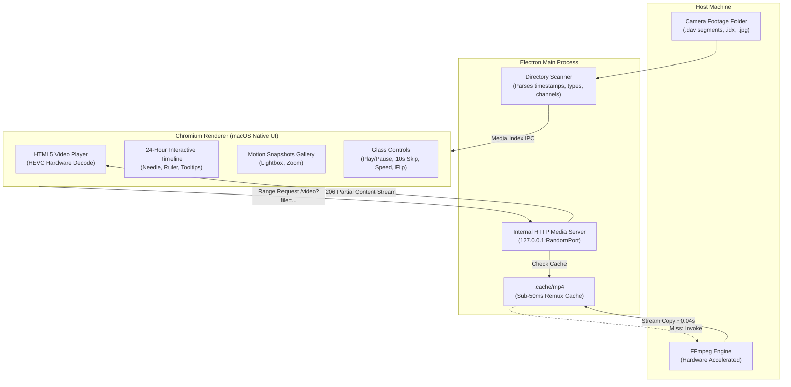

<div align="center">

# 📹 CCTV Viewer
### High-Performance Desktop Surveillance Footage & DAV Media Player

[](LICENSE)
[](https://www.electronjs.org/)
[](https://nodejs.org/)
[](#macos-build)
[](#windows-build)
[](#linux-build)

**A sleek, native desktop application engineered to effortlessly browse, scrub, and stream CCTV surveillance recordings (`.dav` / Dahua / Imou / Hikvision) and motion detection snapshots (`.jpg`).**

[Key Features](#-key-features) • [Architecture](#-architecture) • [Getting Started](#-getting-started) • [Cross-Platform Builds](#-cross-platform-builds--releases) • [Keyboard Shortcuts](#-keyboard-shortcuts)

</div>

---

## 🌟 Key Features

### ⚡ Ultra-Fast DAV Playback
- **Zero Pre-Conversion Waiting:** Security camera DVR dumps typically consist of dozens of 5-minute `.dav` video files encoded in HEVC/H.265. Rather than waiting hours to batch-convert them, **CCTV Viewer** utilizes an internal streaming pipeline that remuxes clips to MP4 on-the-fly in **under 0.05 seconds** using hardware acceleration.
- **HTTP 206 Partial Content (Range Requests):** Instant seeking to any second without buffering the entire segment.

### ⏱️ Interactive 24-Hour Timeline Scrubber
- A continuous 24-hour timeline at the bottom of the window displays your entire day at a glance.
- **Color-Coded Tracks:** Continuous recording periods are highlighted in clean Apple-blue blocks, while motion detection sensor events appear as amber markers.
- **Scrub & Seek:** Click or drag the playhead anywhere on the 24-hour bar to immediately seek to that specific hour, minute, and second, automatically transitioning to the corresponding clip chunk.

### 🔄 180° Flip Mode (Ceiling-Mounted Cameras)
- Many security cameras (such as Dahua, Imou, and Hikvision) are mounted inverted on ceilings.
- **Default 180° Orientation:** All video playback and motion photos default to right-side up.
- **One-Click Toggle:** Click the flip button in the floating glass controls (or press <kbd>R</kbd>) to instantly toggle between 180° and original orientation.
- **Oriented Exports:** Snapshots and exported MP4 clips inherit the active orientation.

### 🎞️ Seamless Continuous Playback
- DVRs split recordings into consecutive 5-minute segments (`00:00-00:05`, `00:05-00:10`, etc.).
- When playback reaches the end of a clip, **CCTV Viewer** seamlessly transitions to the next sequential clip without stutter or user intervention, providing an uninterrupted DVR experience.

### 🖼️ Motion Detection Snapshots Gallery
- Dedicated gallery tab indexing all motion alarm photo captures (`[M]...jpg`).
- Integrated lightbox with full-size zoom, timestamp breakdown, "Show in Finder / Explorer", and instant download.

### 📸 Snapshot & Instant MP4 Export
- **Frame Capture (<kbd>S</kbd>):** Extracts full-resolution still frames with a native camera shutter flash animation.
- **Lossless MP4 Export:** Exports clips to standard, shareable `.mp4` files directly to your preferred folder.

### 🎨 Native macOS Glassmorphism & Custom Scrollbars
- Window Vibrancy (`vibrancy: 'under-window'`), integrated macOS traffic lights, Apple SF Pro typography, floating liquid glass control bar, and thin translucent overlay scrollbars.

---

## 🏗️ Architecture



---

## 🚀 Getting Started

### Prerequisites
- **Node.js**: v18.0.0 or higher
- **npm** or **yarn** / **pnpm**
- **FFmpeg**:
  - **macOS:** `brew install ffmpeg`
  - **Windows:** `winget install Gyan.FFmpeg` or download from [ffmpeg.org](https://ffmpeg.org/download.html)
  - **Linux:** `sudo apt install ffmpeg` (Ubuntu/Debian) or `sudo pacman -S ffmpeg` (Arch)

### Installation
```bash
# Clone the repository
git clone https://github.com/EhsanShahbazii/Imou-Camera-Player.git
cd Imou-Camera-Player

# Install dependencies
npm install

# Start the application
npm start
```

---

## 📦 Cross-Platform Builds & Releases

The application is pre-configured with `electron-builder` to produce production-ready executables and installers for all major operating systems.

### 🍎 macOS Build
Produces signed DMGs and ZIP archives compatible with Apple Silicon (M1/M2/M3/M4) and Intel architectures.
```bash
# Build for current Mac architecture
npm run build:mac

# Build specifically for Apple Silicon (arm64)
npm run build:mac:arm64

# Build specifically for Intel Macs (x64)
npm run build:mac:x64
```
*Output: `dist/CCTV Viewer-1.0.0-arm64.dmg`, `dist/CCTV Viewer-1.0.0-mac.zip`*

### 🪟 Windows Build
Produces both an NSIS installer (`.exe`) and a standalone Portable executable.
```bash
# Standard NSIS Setup Installer
npm run build:win

# Portable single-file executable
npm run build:win:portable
```
*Output: `dist/CCTV Viewer Setup 1.0.0.exe`, `dist/CCTV Viewer 1.0.0.exe` (Portable)*

### 🐧 Linux Build
Produces universal `AppImage` packages and Debian/Ubuntu `.deb` packages.
```bash
# Build all Linux targets
npm run build:linux

# AppImage only
npm run build:linux:appimage

# Debian package only
npm run build:linux:deb
```
*Output: `dist/CCTV Viewer-1.0.0.AppImage`, `dist/cctv-viewer_1.0.0_amd64.deb`*

### 🌐 Build All Platforms
```bash
npm run build:all
```

---

## ⌨️ Keyboard Shortcuts

| Shortcut | Action |
|:---:|:---|
| <kbd>Space</kbd> | Toggle Play / Pause |
| <kbd>←</kbd> | Seek Backward 10 Seconds |
| <kbd>→</kbd> | Seek Forward 10 Seconds |
| <kbd>Shift</kbd> + <kbd>←</kbd> | Previous 5-Minute Segment |
| <kbd>Shift</kbd> + <kbd>→</kbd> | Next 5-Minute Segment |
| <kbd>R</kbd> | Toggle 180° Inverted Orientation |
| <kbd>M</kbd> | Toggle Audio Mute / Unmute |
| <kbd>S</kbd> | Capture High-Resolution Snapshot |
| <kbd>F</kbd> | Toggle Fullscreen Mode |
| <kbd>Esc</kbd> | Close Photo Lightbox / Exit Fullscreen |

---

## 📂 Supported CCTV File Structures

**CCTV Viewer** automatically recognizes Dahua, Imou, and DVR storage schemas:
```text
files/
├── 2026-04-16/
│   └── 001/
│       ├── dav/
│       │   ├── 00/
│       │   │   ├── 00.00.00-00.05.00[R][0@0][0].dav    <-- Regular Recording
│       │   │   └── 00.00.00-00.05.00[R][0@0][0].idx    <-- Frame Index
│       │   └── 04/
│       │       └── 04.24.00-04.27.20[M][0@0][0].dav    <-- Motion Triggered Recording
│       └── jpg/
│           └── 04/
│               └── 24/
│                   └── 19[M][0@0][0].jpg               <-- Motion Snapshot
```
- `[R]`: Regular 24/7 continuous schedule recording.
- `[M]`: Motion sensor alarm event.

---

## 🤖 GitHub Actions Automated Release Workflow

To automatically build and attach `.dmg`, `.exe`, `.AppImage`, and `.deb` binaries to GitHub Releases when pushing a git tag:

Create `.github/workflows/release.yml`:
```yaml
name: Release

on:
  push:
    tags:
      - 'v*.*.*'

jobs:
  release:
    runs-on: ${{ matrix.os }}
    strategy:
      matrix:
        os: [macos-latest, windows-latest, ubuntu-latest]

    steps:
      - name: Checkout Code
        uses: actions/checkout@v4

      - name: Setup Node.js
        uses: actions/setup-node@v4
        with:
          node-version: 20

      - name: Install Dependencies
        run: npm ci

      - name: Build Application
        env:
          GH_TOKEN: ${{ secrets.GITHUB_TOKEN }}
        run: npm run dist
```

---

## 🛡️ Privacy & Security

- **100% Offline & Local:** All video parsing, streaming, and caching occurs entirely on your local machine via `127.0.0.1`.
- **No Cloud Uploads:** Your surveillance videos, audio streams, and snapshot images are never transmitted over the internet.
- **Strict `.gitignore`:** Pre-configured to prevent sensitive camera media, logs, or cache files from ever being committed to source control.

---

## 📄 License

This project is licensed under the [MIT License](LICENSE) - see the LICENSE file for details.

Developed with ❤️ by [Ehsan Shahbazi](https://github.com/EhsanShahbazii)
